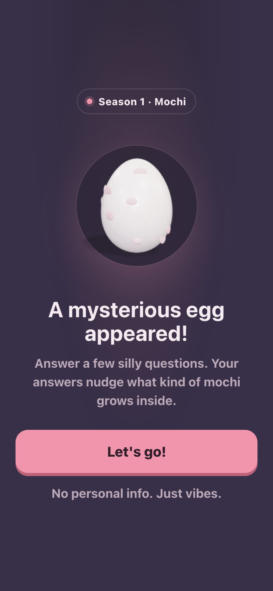
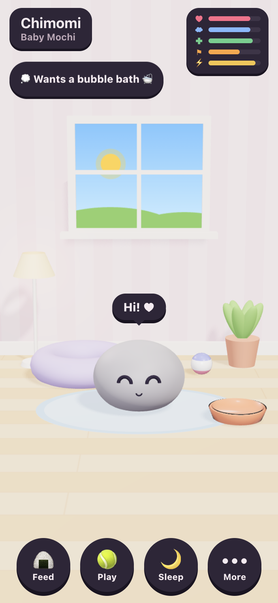
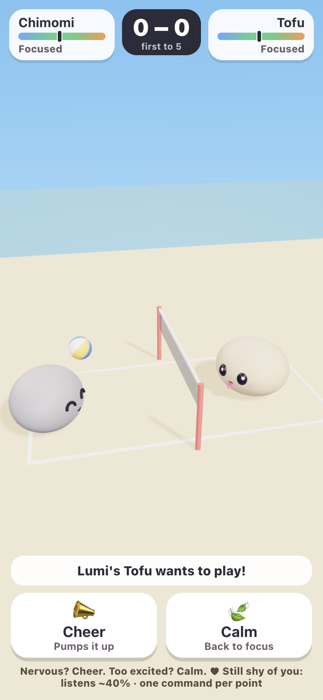
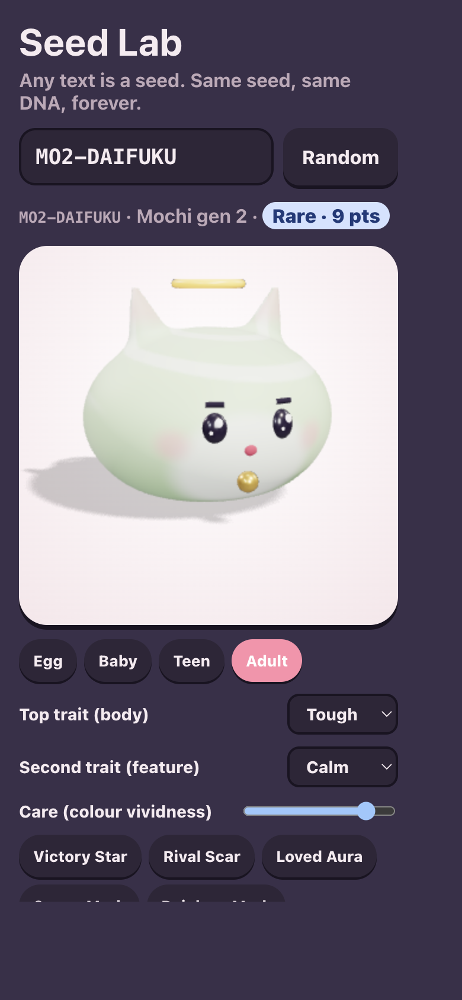

# Pocket Pet Project Guide

Pocket Pet is a small, mobile-first virtual pet game. Hatch a seed-grown mochi, care for it in a 3D room, discover its genetics as it grows, and take it to the beach for a friendly volleyball match. It is designed as a playful browser prototype, not a live-service game.

## At A Glance

- **Platform:** Browser, responsive for phones and desktop; installable PWA shell.
- **Client:** Svelte 5, Vite 8 and JavaScript ES modules.
- **3D:** Three.js, with procedural species models and a Web Worker for the expensive body sculpt.
- **Audio:** Web Audio synthesis; no downloaded sound files are required.
- **State:** The game rules run in the browser and persist to `localStorage`.
- **Current season:** Season 1, Mochi generation 2 (`MO2`). Shiba is registered as a very rare species.
- **Privacy:** The hatch quiz asks playful preference questions, not personal information.

## Screenshots

These are mobile captures of the playable app. The complete set is linked below.

### First Hatch





### Play





Other captures: [quiz](screenshots/02-quiz.png), [egg](screenshots/03-egg.png), [naming](screenshots/04-naming.png), [pet card](screenshots/06-pet-card.png), [stats](screenshots/07-stats.png), [More menu](screenshots/08-more.png), [room decorating](screenshots/09-decorate.png), and [volleyball matchmaking](screenshots/10-volleyball.png).

## How To Play

### Hatch And Discover

1. Answer six lighthearted two-choice questions. Each answer nudges the odds for personality; it does not collect personal data.
2. Tap the egg five times to hatch it.
3. Give the new pet a name. The name can be changed later from its Pet Card.
4. Learn the pet's genes over time. Some traits are visible from Baby, while other genes and parts are revealed at Teen or Adult.

Each egg receives a unique seed code. That code determines the pet's species generation, name, genes, colours, proportions, fine visual fingerprint, birthmark, and possible mutations. The quiz nudges talent, temperament, and quirk. See [DNA.md](DNA.md) for the frozen generation tables and extension rules.

### Care For The Pet

The 3D room is the main play screen. The pet wanders, reacts, sleeps, and performs animations in response to actions. The five meters are Happiness, Comfort, Health, Fitness, and Energy. Meters drift over time but cannot fall below 5, so pets never die. If Energy gets low enough, a pet puts itself to bed and recovers while asleep.

| Action | How to do it | Trait that grows |
|---|---|---|
| Feed | Feed button or tap the bowl | Tough |
| Play | Play button or tap the ball | Playful |
| Sleep / wake | Sleep button or tap the bed | Calm while resting |
| Pat | Tap the pet | Bond |
| Train | More menu | Strong |
| Bath | More menu | Calm |
| Clean | Tap a mess on the floor | Calm |

Some furniture is interactive without changing care: the lamp toggles, the window comments on weather and time, and the plant, toy box, and cushion prompt pet chatter. Feeding, bathing, training, and play have rules and anti-spam limits; for example, training and play need enough Energy, bathing has a cooldown, and messes are limited.

Trait growth is capped at 20 base points per local day and 150 points total. The pet's Talent grows 1.5 times faster. The daily cap resets with the player's local calendar day.

### Bond, Wishes, And Visits

Bond starts at 20 out of 100. Successful care adds bond, pats add smaller amounts, the first visit of a day adds bond, and a match adds bond whether won or lost. Ordinary bond gain is limited to 8 per day; neglect slowly reduces bond when average care is very low. A granted daily wish adds 3 bond outside that ordinary cap.

Each pet has one daily wish, such as a snack, a game of ball, a bath, training, three pats, or a volleyball match. The wish is derived from the pet's code, the date, and personality weights. Granting it also adds 5 Happiness. After being away for at least 30 minutes, the pet greets the player according to their bond.

### Grow Up

Growth is based on both age and earned traits:

| Stage | Requirement |
|---|---|
| Egg | Five taps to hatch |
| Baby | Newly hatched |
| Teen | At least one day old and 25 total trait points |
| Adult | At least three days old and 70 total trait points |

The top trait shapes the Teen body and face. The second trait adds an Adult feature. Raising changes the pet's expression, body proportions, and accessories; the base seed genes remain fixed. Care quality also slowly affects colour vividness. History can add memory marks and match badges.

### Volleyball

Volleyball is a friendly 1-vs-1 beach match against one of three simulated friends. The first pet to 5 points wins, and up to five matches can be started per day. The game simulates every serve, receive, and hit. The player can Cheer to raise mood or Calm to return mood toward focus, once per point. Whether the pet follows a command depends on bond. Strong, Playful, Tough, and Calm traits influence Power, Speed, Receive, and Focus respectively.

Match rewards are cosmetic: records, streaks, badges, and memory marks. An unfinished match is saved and resumes rather than allowing a reroll. The friends and leaderboard are generated locally; there are no real online opponents yet.

### Decorate And Explore

The Decorate mode lets players move and rotate furniture, add room items, and change wall, floor, and rug styles. The room layout is saved with the local game state. Pet movement respects furniture collisions.

Open the Seed Lab at `/?lab` to enter arbitrary seed text, inspect its DNA and rarity, preview the model at each growth stage, change the body form and care vividness, toggle marks, or browse rare-part showcase seeds and a random litter. Add `&dev` to adopt the seed being previewed as the current pet. Seed Lab is a development and collection tool, not a required part of the normal play loop.

## Rules And Time

The game does not run care timers in the background. Each API request advances the pet from its last update in ten-minute simulation steps, then returns a read-only state for the UI. Catch-up is bounded to seven days. This makes returning after time away use the same rules as being online, without a continuously running simulation.

Weather is stable for a local calendar day; the room also reflects local time of day. Optional reminders forecast likely needs and the pending wish, skip quiet hours from 21:00 to 08:00, and schedule at most three notifications per day. They are best-effort browser notifications: there is no remote push service to wake every device reliably.

## Architecture

The client and game rules are deliberately separated. `src/server/` is named for the intended authority boundary, but **it currently runs in the browser**. The UI calls it through one asynchronous API and receives copied state; it does not mutate pet rules directly.

| Area | Responsibility |
|---|---|
| [src/server/constants.js](../src/server/constants.js) | Care rates, caps, stages, bond, wishes, reminders, traits, and labels. |
| [src/server/dna.js](../src/server/dna.js) | Quiz answers and deterministic personality nudges. |
| [src/server/pet.js](../src/server/pet.js) | Pet creation, care actions, time catch-up, traits, evolution, wishes, bond, and forecast. |
| [src/server/battle.js](../src/server/battle.js) | Volleyball simulation, mood, command handling, and simulated friends. |
| [src/server/room.js](../src/server/room.js) | Room layout defaults, item placement validation, and sanitization. |
| [src/server/genome/](../src/server/genome/) | Seed-code decoding and versioned, frozen species-generation tables. |
| [src/server/index.js](../src/server/index.js) | Browser prototype API handlers, local database, migrations, save state, and view copies. |
| [src/lib/api.js](../src/lib/api.js) | The UI's single entry point to the game rules. |
| [src/lib/game.svelte.js](../src/lib/game.svelte.js) | Svelte reactive store, event presentation, toasts, animation and sound cues. |
| [src/lib/reminders.js](../src/lib/reminders.js) | Forecast-to-notification bridge; never changes game state. |
| [src/components/](../src/components/) | Onboarding, room controls, sheets, pet card, evolution, battle UI, and Seed Lab. |
| [src/three/](../src/three/) | 3D room, furniture, volleyball court, turntable viewer, shared materials, and thumbnails. |
| [src/species/](../src/species/) | Species art builders and shared sculpting code. Species art loads on demand. |
| [public/sw.js](../public/sw.js) | Basic PWA cache and service-worker notification handling. |

The pet save is stored under `pocketpet.db.v1` in browser storage, with a database version and migration path. Genome is recomputed from the stored seed code so the save does not become an editable copy of all DNA. The API facade is intended to make a future backend port local to the API boundary and server handlers; that migration has not been implemented.

## Project Map

```text
src/
  App.svelte              Chooses onboarding, room, lab, and overlays
  main.js                 Mounts Svelte, global CSS, audio unlock, service worker
  app.css                 Theme variables and global browser styles
  components/             Player-facing Svelte views and controls
  lib/                    API facade, reactive game store, audio, reminders
  server/                 Game rules, save/API prototype, DNA and tests
  species/                Procedural species model builders and sculpt worker
  three/                  Room, court, viewer, rendering helpers
public/
  sw.js                   Offline cache and best-effort reminder handling
  manifest.webmanifest    Install metadata
docs/
  DNA.md                  DNA format, generation rules, rarity, safe changes
  PROJECT_GUIDE.md        This guide
  screenshots/            Captured screen references
scripts/
  smoke.mjs               Playwright end-to-end smoke flow and screenshots
```

## Run And Test

Use Node.js and npm from the repository root:

```bash
npm ci
npm run dev       # Vite dev server at http://localhost:5173
npm test          # Vitest unit tests
npm run build     # Production PWA assets in dist/
npm run preview   # Serve the production build locally
```

The optional browser smoke flow runs against `dist/` and captures many gameplay states into the git-ignored `screenshots/` directory:

```bash
npm run build
npx playwright install chromium
npm run smoke
```

Use `npm run smoke -- --software` to request SwiftShader where hardware WebGL is unavailable. The project script needs Playwright's browser binary; a browser already open in VS Code does not automatically install that binary for the script.

Prototype query parameters:

| URL | Purpose |
|---|---|
| `/?dev` | Show the development panel for advancing the game clock or resetting the local save. |
| `/?lab` | Open Seed Lab. |
| `/?lab&seed=MO2-DAIFUKU` | Open Seed Lab on a chosen seed. |
| `/?lab&dev` | Enable the Seed Lab adopt action. |

## Prototype Boundaries

This is intentionally a small, fun project. The playable loop is implemented, but the following are not: accounts, cloud saves, a real backend, real friends or visits, remote push notifications, additional shipped seasonal species, fusion, enchanting, and Pet Dash. Browser storage is device- and browser-specific; clearing site data removes the save. WebGL is required for the 3D room, although the UI reports when WebGL is unavailable. The current Shiba art and genome are prepared in code but are only obtainable through the deliberately rare spawn in normal egg creation.

The most detailed low-level reference is [DNA.md](DNA.md), including the rule that a released seed code must always decode to the same genes.